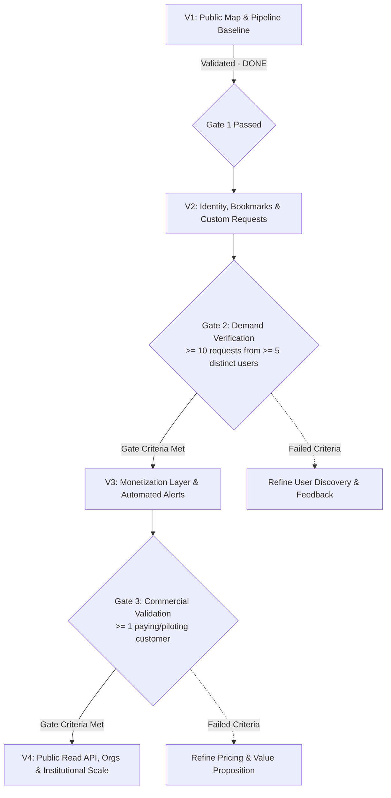

# V2–V4 Comprehensive Implementation Plan & Architecture Specification
**Live Economy Map (Shadow Economy Map)**
**Target Versions:** V2 (Identity & Requests), V3 (Monetization Layer), V4 (API & Scale)  
**Date:** October 2026  
**Status:** Approved for Implementation  
**Git Branch:** `feat/v2-v4-implementation-plan`

---

## 1. Executive Summary & Context

The **Live Economy Map** (originally developed as the Shadow Economy Map) provides high-resolution spatial intelligence identifying informal and emerging economic activity across urban centers. 

### 1.1 V1 Baseline Accomplishments (Completed & Validated)
- **Spatial Foundation:** Fixed ~2.4km spatial grid over Addis Ababa with centroid and polygon boundary GeoJSON.
- **Multi-Source Satellite & Data Pipeline:** Automated ingest and normalization for VIIRS (nighttime lights), GHSL (built-up surface area), RWI (relative wealth index), and GDELT (event density).
- **Composite Scoring:** Configurable weight configurations (`ScoreWeightConfig`, `SourceWeight`) computing historical snapshots (`CompositeScoreSnapshot`) per period.
- **Public & Admin Portals:** Public interactive heatmap exploration, published case study repository with evidence tiers, dynamic about/analytics endpoints, and admin pipeline management.
- **Codebase & Architecture:** Clean layered TypeScript/Express backend with Prisma ORM, Zod validation, Pino structured logging, and comprehensive Vitest unit and integration test suites.

### 1.2 Strategic Scope & Policy Updates
1. **Second City Deferred:** Oct 2026 team consensus formally defers physical integration of a second municipality (e.g., Dire Dawa or Hawassa) out of V4. The codebase must enforce strict geographic parameterization (bounding box, resolution, and coordinate configs loaded dynamically from settings/env) so secondary cities can be onboarded seamlessly without schema or logic rewrites.
2. **Authentication Modernization:** V1's "single admin login, no RBAC" documented in `02-requirements` and `Doc 4 Design Decisions` is **SUPERSEDED FOR V2**. V2 transitions to a unified identity model supporting public user registration, email verification, password resets, and role-based access control (`USER` vs `ADMIN`).
3. **Doc-First Rigor:** Development across all versions strictly adheres to the established 7-stage engineering lifecycle:
   $$\text{Docs 01–04} \longrightarrow \text{API + Data Model} \longrightarrow \text{Frontend Spec} \longrightarrow \text{Function Specs} \longrightarrow \text{Test Specs} \longrightarrow \text{Implementation (src/)} \longrightarrow \text{QA + Gate Review}$$

---

## 2. Team Structure & Role Assignments

The 6-member engineering team is mapped to the core roles required across V2–V4:

| Role Identifier | Assigned Team Member | Primary Specialization & Core Responsibilities |
|---|---|---|
| **BE1 (Auth, Security & Core API)** | **Aneni Kidanu Manale** | Public auth lifecycle (JWT/sessions), role guards, password hashing, email token management, rate limiting, `/me` profile endpoints, user database migrations. |
| **BE2 (Pipelines, Analytics, Payments & Jobs)** | **Anteneh Wondwosen** | Saved areas, report request state machine, Chapa billing integration, pipeline alert engine, AI report generation, public read API, and spatial configuration. |
| **FE1 (Public Portal & Client UI)** | **Abrham Nega** | Public user registration/login/verification flows, header auth state, bookmarking in inspect panels, Saved Areas page, Request Report form, client billing/checkout UI. |
| **FE2 (Admin Portal & Dashboards)** | **Abenezer Getamesay** | Admin request management queue, deliverable uploads, demand metrics dashboard, payment management screens, AI draft editor & approval flow, institutional dashboard. |
| **QA & Security Testing Lead** | **Adugna (aduch123)** | Test plan execution, Vitest backend & frontend suites, security audit (OWASP, timing attack prevention, webhook signature verification), regression testing of V1 baseline. |
| **Docs, Specs & Compliance Lead** | **Meseret Birhanu Nigus** | Documentation maintenance (01–04 specs), API documentation (OpenAPI/Swagger), methodology and billing copy updates, gate metric tracking sheets. |

---

## 3. Version Progression & Gate Criteria



- **V1 → V2 Gate:** Complete V1 baseline with all data sources, map endpoints, admin pipeline, and case studies operational. **[STATUS: PASSED]**
- **V2 → V3 Gate:** Documented empirical demand. Criteria: **$\ge 10$ custom report requests submitted by $\ge 5$ distinct, verified non-admin users**. Calculated via `GET /api/v1/admin/metrics/demand`.
- **V3 → V4 Gate:** Direct commercial traction. Criteria: **$\ge 1$ paying subscriber or institutional pilot organization** with an active, verified subscription.

---

## 4. Current V1 Architecture & Implementation Audit

The existing backend under `c:\Users\HP\Desktop\insagrad\backend` demonstrates a disciplined, modular design:

```
src/
├── config/                  # Database client, environment parsing via Zod
├── constants/               # HTTP status codes, stale thresholds
├── controllers/             # Express handlers wrapped in asyncHandler
├── middlewares/             # validate, auth, rateLimiter, error
├── routes/                  # Express sub-routers mounted under /api/v1
├── schemas/                 # Zod validation schemas for params, queries, bodies
├── services/                # Business logic and Prisma interactions
├── types/                   # TypeScript interfaces, DTOs, enum definitions
└── utils/                   # ApiError, ApiResponse, Logger (Pino), JWT, AI clients, Data Source SDKs
```

### 4.1 Key Architecture Findings & Design Decisions
1. **Strict Layering:** Routes bind schemas via `validate(schema)` middleware. Controllers only handle request unmarshalling and response envelope construction using `ApiResponse(status, message, data)`. Services contain pure business logic and Prisma calls.
2. **Prisma 7 Standard:** Database queries utilize Prisma 7 configured without deprecated preview flags. Migrations are tracked under `prisma/migrations/`.
3. **Admin Model & Auth:** Admin authentication uses bcrypt hashing with constant-time dummy comparisons (`DUMMY_HASH`) to prevent timing-based user enumeration. Sessions are stateless JWT tokens signed with `JWT_SECRET`.
4. **Data Isolation:** Data sources (`VIIRS`, `GHSL`, `RWI`, `GDELT`) are isolated in `DataSource` models. Spatial grids (`GridCell`) store boundaries in standard GeoJSON format to preserve database portability without requiring PostGIS extensions.
5. **Testing Architecture:** Vitest test suites strictly mirror `src/` (e.g. `tests/schemas`, `tests/controllers`, `tests/services`, `tests/routes`). Mocking for database operations utilizes `src/config/__mocks__/db.ts`.

---

## 5. V2 — Identity & Requests Implementation Plan

### 5.1 Objectives & Scope
Transform the read-only application into an interactive engagement platform where verified users can bookmark grid cells and submit targeted requests for deep-dive economic analyses.

### 5.2 Architectural Decision: Unified User Model with RBAC
The team has decided to unify admin and user authentication under a single, extensible `User` model:
- Deprecates separate `Admin` table.
- Introduces `Role` enum: `USER`, `ADMIN`.
- Existing admin records migrate into `User` with `role = ADMIN`.
- Foreign keys for `PipelineRun.triggeredById`, `ScoreWeightConfig.createdById`, and `CaseStudy.createdById` are updated to reference `User.id`.
- Replaces admin-only login with standard `/api/v1/auth/login` while preserving role-based middleware guards (`requireRole('ADMIN')`).

### 5.3 V2 Data Model Extensions (`prisma/schema.prisma`)

```prisma
enum Role {
  USER
  ADMIN
}

enum TokenType {
  EMAIL_VERIFICATION
  PASSWORD_RESET
}

enum RequestStatus {
  SUBMITTED
  IN_REVIEW
  IN_PROGRESS
  DELIVERED
  REJECTED
}

enum ContactPreference {
  EMAIL
  PHONE
  TELEGRAM
}

model User {
  id               String    @id @default(uuid())
  email            String    @unique
  password         String    // bcrypt hash
  role             Role      @default(USER)
  fullName         String?
  organizationName String?
  isEmailVerified  Boolean   @default(false)
  createdAt        DateTime  @default(now())
  updatedAt        DateTime  @updatedAt

  emailTokens           EmailToken[]
  savedAreas            SavedArea[]
  reportRequests        ReportRequest[]       @relation("UserReportRequests")
  assignedReportRequests ReportRequest[]      @relation("AdminAssignedRequests")
  requestEvents         ReportRequestEvent[]  @relation("ActorRequestEvents")
  uploadedDeliverables  ReportDeliverable[]   @relation("AdminUploadedDeliverables")
  pipelineRuns          PipelineRun[]         @relation("PipelineRunTriggeredBy")
  scoreWeightConfigs    ScoreWeightConfig[]   @relation("ScoreWeightConfigCreatedBy")
  caseStudies           CaseStudy[]           @relation("CaseStudyCreatedBy")

  @@index([role])
  @@index([isEmailVerified])
}

model EmailToken {
  id        String    @id @default(uuid())
  userId    String
  user      User      @relation(fields: [userId], references: [id], onDelete: Cascade)
  tokenHash String    @unique
  type      TokenType
  expiresAt DateTime
  usedAt    DateTime?
  createdAt DateTime  @default(now())

  @@index([tokenHash, type])
}

model SavedArea {
  id          String   @id @default(uuid())
  userId      String
  user        User     @relation(fields: [userId], references: [id], onDelete: Cascade)
  gridCellId  String
  gridCell    GridCell @relation(fields: [gridCellId], references: [id], onDelete: Restrict)
  customName  String?
  notes       String?
  createdAt   DateTime @default(now())
  updatedAt   DateTime @updatedAt

  @@unique([userId, gridCellId])
  @@index([userId])
}

model ReportRequest {
  id                 String            @id @default(uuid())
  userId             String
  user               User              @relation("UserReportRequests", fields: [userId], references: [id], onDelete: Restrict)
  title              String
  questionPrompt     String
  areaCellIds        Json              // Array of GridCell UUID strings
  orgType            String?           // e.g. "Research", "Commercial", "Government", "NGO"
  contactPreference  ContactPreference @default(EMAIL)
  status             RequestStatus     @default(SUBMITTED)
  priority           Boolean           @default(false)
  assignedAdminId    String?
  assignedAdmin      User?             @relation("AdminAssignedRequests", fields: [assignedAdminId], references: [id], onDelete: SetNull)
  internalNotes      String?
  createdAt          DateTime          @default(now())
  updatedAt          DateTime          @updatedAt

  events             ReportRequestEvent[]
  deliverables       ReportDeliverable[]

  @@index([userId])
  @@index([status])
  @@index([assignedAdminId])
}

model ReportRequestEvent {
  id             String         @id @default(uuid())
  requestId      String
  request        ReportRequest  @relation(fields: [requestId], references: [id], onDelete: Cascade)
  actorId        String
  actor          User           @relation("ActorRequestEvents", fields: [actorId], references: [id], onDelete: Restrict)
  previousStatus RequestStatus?
  newStatus      RequestStatus
  note           String?
  createdAt      DateTime       @default(now())

  @@index([requestId, createdAt])
}

model ReportDeliverable {
  id            String        @id @default(uuid())
  requestId     String
  request       ReportRequest @relation(fields: [requestId], references: [id], onDelete: Cascade)
  fileUrl       String
  fileName      String
  fileSizeBytes Int
  mimeType      String
  uploadedById  String
  uploadedBy    User          @relation("AdminUploadedDeliverables", fields: [uploadedById], references: [id], onDelete: Restrict)
  createdAt     DateTime      @default(now())

  @@index([requestId])
}
```

### 5.4 V2 API Specifications

#### Authentication & Profile (`/api/v1/auth`, `/api/v1/me`)
- `POST /auth/register`: Register new account with email, password, full name. Creates inactive email verification token and triggers email event.
- `POST /auth/login`: Authenticate email and password. Returns JWT token and sanitized user profile with role.
- `POST /auth/logout`: Invalidate client session.
- `POST /auth/verify-email`: Validate email verification token and update `isEmailVerified = true`.
- `POST /auth/forgot-password`: Generates secure password reset token and dispatches transactional reset link.
- `POST /auth/reset-password`: Validates token and updates user password with newly hashed bcrypt string.
- `GET /me`: Return authenticated user profile.
- `PATCH /me`: Update editable user profile fields (`fullName`, `organizationName`).

#### Saved Areas (`/api/v1/me/saved-areas`)
- `GET /me/saved-areas`: List all bookmarked cells for authenticated user with joined `GridCell` spatial data and latest composite scores.
- `POST /me/saved-areas`: Save a cell with optional custom name and notes.
- `PATCH /me/saved-areas/:id`: Update bookmark custom label or notes.
- `DELETE /me/saved-areas/:id`: Remove bookmark.

#### User Report Requests (`/api/v1/me/report-requests`)
- `POST /me/report-requests`: Submit custom report request. Validates referenced cell UUIDs and creates initial `SUBMITTED` event log.
- `GET /me/report-requests`: Retrieve all requests submitted by user with current status, history events, and deliverable links.
- `GET /me/report-requests/:id`: Fetch specific request details.

#### Admin Request Management & Demand Metrics (`/api/v1/admin`)
- `GET /admin/report-requests`: Filterable, paginated queue (status, date range, priority, assigned admin).
- `PATCH /admin/report-requests/:id`: Update status, assignee, or append internal notes. Automatically appends audit row in `ReportRequestEvent` and triggers transactional status notification email.
- `POST /admin/report-requests/:id/deliverable`: Upload or link completed deliverable file.
- `GET /admin/metrics/demand`: Returns aggregated demand data verifying V2 → V3 gate criteria:
  - Total requests submitted
  - Distinct non-admin user count
  - Conversion breakdown by status
  - Gate status flag (`isGateMet: boolean`)

### 5.5 V2 Task Matrix & Responsibilities

```
========================================================================================
MEMBER            TASK DESCRIPTION                                            DEPENDENCY
========================================================================================
Aneni (BE1)       1. Auth module: register, login, logout, verify, reset      None
                  2. Role guard middleware & rate limiter on auth routes       1
                  3. Prisma migration: User, EmailToken, relations            None
                  4. /me endpoints & user profile management                  1, 3
----------------------------------------------------------------------------------------
Anteneh (BE2)     1. Saved areas module: controller, service, schema          Stub Auth
                  2. Report requests module & state machine transitions       Stub Auth
                  3. Event audit logging & deliverable attachments            2
                  4. Transactional email notification service                 2
                  5. Demand metrics endpoint for V2 -> V3 gate                2
----------------------------------------------------------------------------------------
Abrham (FE1)      1. Public Auth UI: Login, Register, Verify Email, Reset     BE1 API docs
                  2. Header authentication state & profile dropdown           1
                  3. Bookmark button in Map CellDetailPanel                   BE2 API docs
                  4. Saved Areas management page                              3
                  5. Request Custom Report modal & My Requests tracking page  BE2 API docs
----------------------------------------------------------------------------------------
Abenezer (FE2)    1. Admin Request Queue: table, status filters, search       BE2 API docs
                  2. Request Detail Drawer: status change, notes, assignees   1
                  3. Deliverable file uploader UI                             2
                  4. V2 -> V3 Demand Metrics overview card on Admin Dashboard 1
----------------------------------------------------------------------------------------
Adugna (QA)       1. Vitest test suites for Auth, Saved Areas, Requests       BE1, BE2
                  2. Security checklist: timing attacks, password hashing     BE1
                  3. State machine validation & regression testing of V1      BE2
                  4. Gate metrics tracking verification sheet                 BE2
----------------------------------------------------------------------------------------
Meseret (Docs)    1. Update 01-system-overview & 02-requirements (mark        None
                     superseded lines for single admin / no RBAC)
                  2. Document V2 API specs & update Postman/OpenAPI schema    BE1, BE2
                  3. Define email copy templates for transactional alerts     BE2
========================================================================================
```

---

## 6. V3 — Monetization Layer Implementation Plan

### 6.1 Objectives & Scope
Monetize analytical insights by introducing tiered subscriptions, Chapa payment processing, self-serve score data exports, automated spatial anomaly alerts, and semi-automated AI draft reporting.

### 6.2 Payment Integration Architecture (Chapa)
- **Integration Flow:** User selects Plan $\rightarrow$ Server calls Chapa API (`POST /v1/transaction/initialize`) with unique `tx_ref` $\rightarrow$ User redirected to checkout $\rightarrow$ Chapa fires signed webhook to server $\rightarrow$ Server verifies HMAC-SHA256 signature against `CHAPA_WEBHOOK_SECRET` $\rightarrow$ Idempotent processing updates subscription status.
- **Server Verification:** Secondary automated verification check via `GET https://api.chapa.co/v1/transaction/verify/{tx_ref}` before activating entitlements.
- **Security & Compliance:** Zero raw credit card or financial instrument data stored locally. Complete payment transaction audit log maintained.

### 6.3 V3 Data Model Extensions (`prisma/schema.prisma`)

```prisma
enum PlanInterval {
  MONTHLY
  YEARLY
}

enum SubscriptionStatus {
  INCOMPLETE
  ACTIVE
  PAST_DUE
  CANCELED
  EXPIRED
}

enum PaymentStatus {
  PENDING
  SUCCESS
  FAILED
}

enum DraftStatus {
  DRAFT
  IN_REVIEW
  APPROVED
  DELIVERED
}

model Plan {
  id              String        @id @default(uuid())
  name            String        @unique // e.g., "Free", "Analyst Pro", "Enterprise"
  priceEtb        Int           // Stored in ETB cents/integers
  interval        PlanInterval  @default(MONTHLY)
  canExport       Boolean       @default(false)
  canAlert        Boolean       @default(false)
  priorityReports Boolean       @default(false)
  maxAlerts       Int           @default(0)
  isActive        Boolean       @default(true)
  createdAt       DateTime      @default(now())
  updatedAt       DateTime      @updatedAt

  subscriptions   Subscription[]
}

model Subscription {
  id                   String             @id @default(uuid())
  userId               String             @unique
  user                 User               @relation(fields: [userId], references: [id], onDelete: Restrict)
  planId               String
  plan                 Plan               @relation(fields: [planId], references: [id], onDelete: Restrict)
  status               SubscriptionStatus @default(INCOMPLETE)
  currentPeriodStart   DateTime
  currentPeriodEnd     DateTime
  cancelAtPeriodEnd    Boolean            @default(false)
  createdAt            DateTime           @default(now())
  updatedAt            DateTime           @updatedAt

  payments             Payment[]
  exportLogs           ExportLog[]
}

model Payment {
  id              String        @id @default(uuid())
  subscriptionId  String
  subscription    Subscription  @relation(fields: [subscriptionId], references: [id], onDelete: Restrict)
  txRef           String        @unique
  amountEtb       Int
  status          PaymentStatus @default(PENDING)
  rawWebhookJson  Json?
  verifiedAt      DateTime?
  createdAt       DateTime      @default(now())

  @@index([txRef])
  @@index([status])
}

model AlertRule {
  id              String    @id @default(uuid())
  userId          String
  user            User      @relation(fields: [userId], references: [id], onDelete: Cascade)
  gridCellId      String
  gridCell        GridCell  @relation(fields: [gridCellId], references: [id], onDelete: Restrict)
  thresholdDelta  Float     // Absolute or percentage score change trigger (e.g. 0.15)
  isActive        Boolean   @default(true)
  lastTriggeredAt DateTime?
  createdAt       DateTime  @default(now())
  updatedAt       DateTime  @updatedAt

  @@unique([userId, gridCellId])
  @@index([isActive])
}

model Notification {
  id        String   @id @default(uuid())
  userId    String
  user      User     @relation(fields: [userId], references: [id], onDelete: Cascade)
  title     String
  message   String
  isRead    Boolean  @default(false)
  createdAt DateTime @default(now())

  @@index([userId, isRead])
}

model ReportDraft {
  id          String        @id @default(uuid())
  requestId   String
  request     ReportRequest @relation(fields: [requestId], references: [id], onDelete: Cascade)
  aiModel     String        // e.g. "llama-3.3-70b-versatile" via Groq
  draftContent String       // Markdown generated analysis
  status      DraftStatus   @default(DRAFT)
  reviewerId  String?
  reviewer    User?         @relation(fields: [reviewerId], references: [id], onDelete: SetNull)
  reviewNotes String?
  createdAt   DateTime      @default(now())
  updatedAt   DateTime      @updatedAt

  @@index([requestId])
  @@index([status])
}

model ExportLog {
  id              String        @id @default(uuid())
  subscriptionId  String
  subscription    Subscription  @relation(fields: [subscriptionId], references: [id], onDelete: Restrict)
  format          String        // "CSV" | "JSON"
  cellCount       Int
  createdAt       DateTime      @default(now())
}
```

### 6.4 V3 API Specifications
- `GET /plans`: Public list of available subscription tiers and entitlements.
- `POST /billing/checkout`: Initiates Chapa checkout for selected plan. Returns redirect URL.
- `POST /billing/webhook/chapa`: Chapa webhook endpoint verifying HMAC-SHA256 signature and idempotently updating subscription.
- `GET /billing/verify/:tx_ref`: Manual/fallback verification endpoint.
- `GET /me/subscription`: Returns active subscription details, renewal date, and entitlements.
- `GET /me/export`: Downloads historical score time series in CSV or JSON format (guarded by `requireEntitlement('canExport')`).
- `GET/POST/PATCH/DELETE /me/alerts`: CRUD management for user spatial alert thresholds.
- `GET /me/notifications` & `PATCH /me/notifications/:id/read`: In-app notification center.
- `POST /admin/report-requests/:id/draft`: Admin-triggered AI draft generation combining cell historical signals, case study comparisons, and LLM synthesis.
- `PATCH /admin/drafts/:id`: Admin review, modification, and approval workflow (`DRAFT` $\rightarrow$ `APPROVED`).
- `GET /admin/payments` & `PATCH /admin/subscriptions/:id`: Admin billing management and manual grant overrides.

### 6.5 V3 Task Matrix & Responsibilities

```
========================================================================================
MEMBER            TASK DESCRIPTION                                            DEPENDENCY
========================================================================================
Aneni (BE1)       1. Plans & subscription data models & migrations            V2 Gate
                  2. Entitlement verification middleware                      1
                  3. Chapa checkout initialization & webhook processor        1
                  4. Webhook HMAC-SHA256 signature validator & replay defense 3
                  5. Cron job for subscription expiration check               1
----------------------------------------------------------------------------------------
Anteneh (BE2)     1. Pipeline-integrated spatial alert evaluation engine      V2 Gate
                  2. Notification service (in-app dispatch + email)           1
                  3. Historical time-series export endpoint (CSV / JSON)      Entitlement Guard
                  4. LLM report draft generation using Groq API client        Existing AI Client
                  5. Admin draft review and approval state workflow           4
----------------------------------------------------------------------------------------
Abrham (FE1)      1. Pricing and plan selection page                          BE1 API
                  2. Chapa checkout redirection, success & cancel pages       1
                  3. Subscription & billing management page in user profile   BE1 API
                  4. Historical data export modal on inspect panel            BE2 API
                  5. Spatial alert threshold configurator & notification bell BE2 API
----------------------------------------------------------------------------------------
Abenezer (FE2)    1. Admin Payment audit log & subscription management UI     BE1 API
                  2. AI Draft review editor with inline markdown preview      BE2 API
                  3. Draft approval and deliverable attachment workflow       2
                  4. Priority request badge rendering in admin queue          V2 Admin Queue
----------------------------------------------------------------------------------------
Adugna (QA)       1. Chapa sandbox test suite: replay, duplicate, corrupted   BE1
                     signature, timeout scenarios
                  2. Spatial alert test harnesses with simulated deltas       BE2
                  3. AI draft content quality & hallucination checklist       BE2
                  4. End-to-end payment to entitlement verification test      BE1, FE1
----------------------------------------------------------------------------------------
Meseret (Docs)    1. Update methodology & landing pages with subscription copy None
                  2. Document Chapa webhook security & transaction lifecycles BE1
                  3. Draft guidelines for human-in-the-loop report approvals   BE2
========================================================================================
```

---

## 7. V4 — API Platform, Institutional Orgs & Scale

### 7.1 Objectives & Scope
Scale the Live Economy Map into a multi-tenant institutional intelligence suite. Provide authenticated machine-to-machine developer APIs, multi-member organizational accounts, and institutional watchlists.

### 7.2 Second City Policy & Codebase Parameterization
**Explicit Team Decision (Oct 2026): Physical integration of a second municipality is DEFERRED out of V4.**
- Existing hard-coded references to Addis Ababa in bounding boxes and coordinate constraints are refactored into a dynamic spatial configuration provider.
- All spatial algorithms compute metrics dynamically based on active bounding boxes loaded from runtime configuration.

### 7.3 Developer API Key Platform
- **Key Generation & Storage:** Secure cryptographically random keys (`lem_live_[a-zA-Z0-9]{32}`). Keys are displayed to the user **exactly once** upon creation.
- **Security at Rest:** Hashed using SHA-256 prior to database storage.
- **Metering & Rate Limiting:** Tier-based sliding window rate limiter backed by Redis/memory, logging request counts to `ApiUsage`.

### 7.4 V4 Data Model Extensions (`prisma/schema.prisma`)

```prisma
enum OrgRole {
  OWNER
  ADMIN
  MEMBER
}

model Organization {
  id              String        @id @default(uuid())
  name            String
  slug            String        @unique
  billingEmail    String
  createdAt       DateTime      @default(now())
  updatedAt       DateTime      @updatedAt

  members         OrgMember[]
  watchlists      Watchlist[]
  apiKeys         ApiKey[]
}

model OrgMember {
  id              String        @id @default(uuid())
  organizationId  String
  organization    Organization  @relation(fields: [organizationId], references: [id], onDelete: Cascade)
  userId          String
  user            User          @relation(fields: [userId], references: [id], onDelete: Cascade)
  role            OrgRole       @default(MEMBER)
  createdAt       DateTime      @default(now())

  @@unique([organizationId, userId])
}

model ApiKey {
  id              String        @id @default(uuid())
  userId          String?
  user            User?         @relation(fields: [userId], references: [id], onDelete: Cascade)
  organizationId  String?
  organization    Organization? @relation(fields: [organizationId], references: [id], onDelete: Cascade)
  name            String
  keyPrefix       String        // First 8 characters for identification
  keyHash         String        @unique // SHA-256 hash of complete key
  rateLimitPerMin Int           @default(60)
  isActive        Boolean       @default(true)
  lastUsedAt      DateTime?
  expiresAt       DateTime?
  createdAt       DateTime      @default(now())

  usages          ApiUsage[]

  @@index([keyHash, isActive])
}

model ApiUsage {
  id              String    @id @default(uuid())
  apiKeyId        String
  apiKey          ApiKey    @relation(fields: [apiKeyId], references: [id], onDelete: Cascade)
  endpoint        String
  statusCode      Int
  responseTimeMs  Int
  timestamp       DateTime  @default(now())

  @@index([apiKeyId, timestamp])
}

model Watchlist {
  id              String          @id @default(uuid())
  organizationId  String
  organization    Organization    @relation(fields: [organizationId], references: [id], onDelete: Cascade)
  name            String
  description     String?
  createdAt       DateTime        @default(now())
  updatedAt       DateTime        @updatedAt

  items           WatchlistItem[]
}

model WatchlistItem {
  id              String    @id @default(uuid())
  watchlistId     String
  watchlist       Watchlist @relation(fields: [watchlistId], references: [id], onDelete: Cascade)
  gridCellId      String
  gridCell        GridCell  @relation(fields: [gridCellId], references: [id], onDelete: Restrict)
  createdAt       DateTime  @default(now())

  @@unique([watchlistId, gridCellId])
}
```

### 7.5 V4 API Specifications
- **Public Read API (`/api/v1/...`)**:
  - `GET /api/v1/cells`: Paginated spatial metadata with bounding box filtering.
  - `GET /api/v1/scores`: High-performance bulk score retrieval for specified periods.
  - `GET /api/v1/history/:cellId`: Longitudinal time-series data per cell across all indicators.
  - `GET /api/v1/case-studies`: Public verified ground truth repository.
- **Developer Key Management (`/api/v1/me/api-keys`)**:
  - `POST /me/api-keys`: Create new API key. Returns plaintext secret once.
  - `GET /me/api-keys`: List active keys with usage metrics.
  - `DELETE /me/api-keys/:id`: Revoke key immediately.
  - `GET /me/usage`: Metered request usage summary.
- **Organization & Watchlist Engine (`/api/v1/orgs`)**:
  - `CRUD /orgs`: Organization account lifecycle.
  - `CRUD /orgs/:id/members`: Team membership and role assignments.
  - `CRUD /orgs/:id/watchlists`: Institutional spatial watchlist curation.
  - `GET /orgs/:id/dashboard`: Executive aggregate metrics across watched zones.

### 7.6 V4 Task Matrix & Responsibilities

```
========================================================================================
MEMBER            TASK DESCRIPTION                                            DEPENDENCY
========================================================================================
Aneni (BE1)       1. API Key authentication middleware & SHA-256 hash checks  V3 Gate
                  2. Tiered API rate limiting & usage metering interceptor    1
                  3. Public /api/v1 read endpoint versioning and caching      1
                  4. Organization multi-tenancy models & role guards          1
----------------------------------------------------------------------------------------
Anteneh (BE2)     1. Refactor spatial bounding box and grid resolution logic  None
                     into dynamic configuration provider (no hardcoded Addis)
                  2. Watchlist aggregation and longitudinal summary endpoints 1
                  3. High-throughput score retrieval caching strategy         1
                  4. Usage roll-up background aggregation worker              BE1
----------------------------------------------------------------------------------------
Abrham (FE1)      1. Developer Portal: API key creation modal & secret view   BE1 API
                  2. Interactive API documentation page (embedded OpenAPI)    BE1 API
                  3. Organization switcher in global application header       BE1 API
                  4. API usage and metering charts page                       BE1 API
----------------------------------------------------------------------------------------
Abenezer (FE2)    1. Institutional Dashboard: Multi-area watchlist overview   BE2 API
                  2. Comparative score and trend analytics table              1
                  3. Organization team member invitation and management UI    BE1 API
                  4. Admin API key monitoring and org audit view              BE1 API
----------------------------------------------------------------------------------------
Adugna (QA)       1. High-concurrency load testing of public read endpoints   BE1, BE2
                  2. Key authentication and permission isolation tests        BE1
                  3. End-to-end regression across V1, V2, and V3 surfaces     All
                  4. Rate limit threshold precision verification              BE1
----------------------------------------------------------------------------------------
Meseret (Docs)    1. Author comprehensive public API documentation & guides   BE1, BE2
                  2. Update architecture documentation with org model         BE1
                  3. Document enterprise deployment & SLA guidelines          None
========================================================================================
```

---

## 8. Documentation Impact & Updates (Docs 01–04)

In accordance with our doc-first standard, the core specification documents must be updated immediately upon branch creation:

### 8.1 Updates to `02-requirements.md`
- **Mark Superseded Lines:**
  ```markdown
  [SUPERSEDED FOR V2]: "Single admin login, no public user accounts, no RBAC."
  -> Replaced by FR-2.1 (public user accounts) and FR-2.2 (RBAC with USER and ADMIN roles).
  ```
- **Insert V2 Requirements:** Add sections for FR-2.1 through FR-2.7, NFRs for rate-limiting, bcrypt hashing, and demand-metric query.
- **Insert V3 Requirements:** Add sections for FR-3.1 through FR-3.8 (Chapa billing, alerts, AI drafts).
- **Insert V4 Requirements:** Add sections for FR-4.1 through FR-4.6 (API keys, public read endpoints, orgs). Mark second city as **DEFERRED**.

### 8.2 Updates to `03-architecture-and-data-model.md`
- Add Prisma schema definitions for V2 (`User`, `EmailToken`, `SavedArea`, `ReportRequest`, `ReportRequestEvent`, `ReportDeliverable`).
- Detail migration path transitioning from legacy `Admin` model to unified `User` model.
- Add ER diagrams detailing relational constraints and cascade policies.

### 8.3 Updates to `04-design-decisions.md`
- Record architectural decision: **Unified User Table vs Separate Tables** (Decision: Unified `User` with `role` field).
- Record architectural decision: **Chapa Integration Architecture** (Server-side HMAC-SHA256 webhook signature verification with idempotent transactions).
- Record architectural decision: **Spatial Parameterization** (Decouple Addis Ababa specifics into configuration tables/environment variables).

---

## 9. Immediate Next Steps & Execution Sequence

1. **Branch Created:** Working branch `feat/v2-v4-implementation-plan` active.
2. **Review & Documentation Baseline:** Commit `docs/v2-v4-implementation-plan.md` to repository.
3. **Stage 1 (V2 Sprint 1):**
   - Aneni (BE1) implements `User` & `EmailToken` Prisma schema and runs migration.
   - Anteneh (BE2) implements `SavedArea` and `ReportRequest` models with stub auth guard.
   - Abrham (FE1) and Abenezer (FE2) align frontend state stores with updated API DTO contracts.
   - Adugna (QA) configures Vitest test suites for auth and request state machines.
4. **Integration & Gate Review:** Validate V2 against demand threshold ($\ge 10$ requests from $\ge 5$ distinct users) before commencing V3 Chapa integration.
